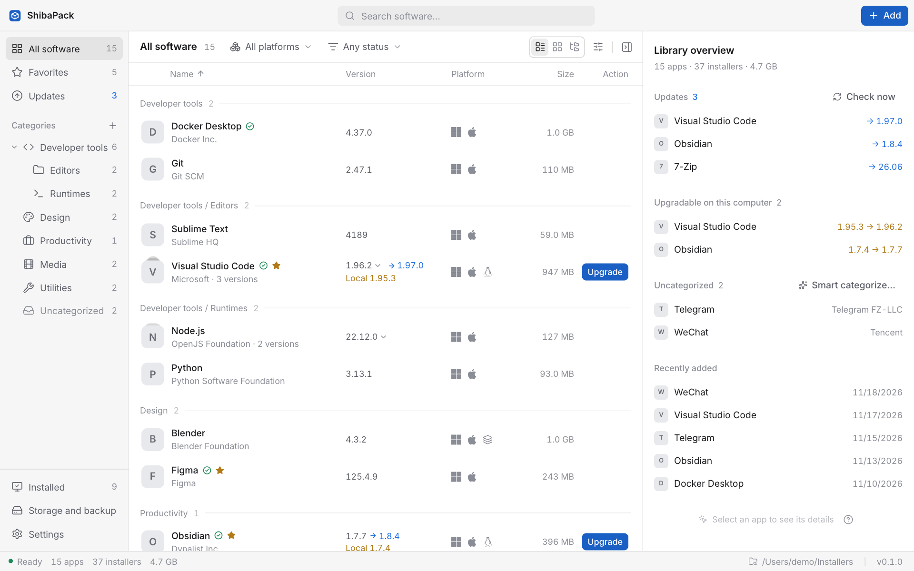
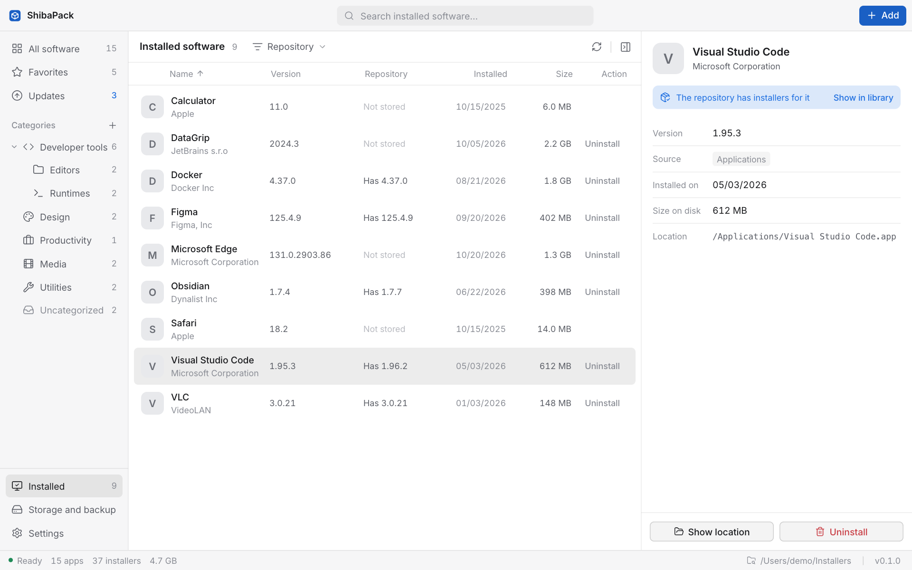
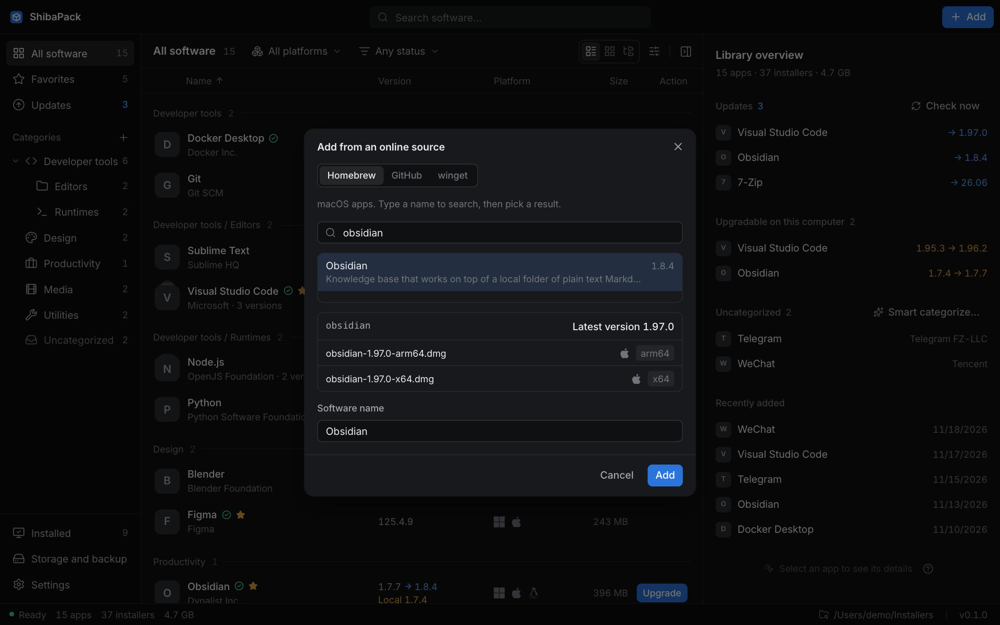

# ShibaPack

**English** · [简体中文](README.zh-CN.md)

A cross-platform manager for software installers. ShibaPack keeps the `.exe`, `.dmg`, `.msi`, `.deb`, `.apk` and other installers on your computer or NAS organized as **app → version → file**, tells you what is installed on this machine, and keeps everything up to date from online sources.

Everything lives in a folder you choose. The index is a plain `software.json` file at its root. There is no database.



## Features

- **Organized by app and version.** Drop installers in and ShibaPack reads the app name, version, platform and architecture from the file name, then files them as `App/Version/file`. Duplicates are detected by SHA-256.
- **Two ways to store files.** *Managed* copies installers into the library folder. *Indexed* only records where a file already is (for example on a NAS) and never moves it.
- **Several versions per app.** Pick a default version or always use the newest, see which version is installed on this computer, and clean up old versions in one step.
- **Categories, favorites and smart categorize.** Nested categories, drag and drop to file apps, and a built-in, offline rule set that suggests a category for about 300 well-known apps.
- **Installed software.** Lists the apps installed on this computer, matches them with your library, and shows which ones can be upgraded from an installer you already have. Install, upgrade and uninstall from one place.
- **Online sources.** Link an app to Homebrew Cask, GitHub Releases or winget to check for new versions and download them into the library.
- **Real icons.** Icons are taken from installers and installed apps. For apps with a homepage or a GitHub repository, ShibaPack can also use the site icon or the repository owner's avatar. Apps without an icon get a plain gray letter tile.
- **Safe by default.** The index is backed up automatically (the last 8 copies, plus one per day for two weeks) and always right before a delete, deleted files go to a trash folder for 30 days, and a check finds files that went missing or changed size.
- **Offline catalog.** Optionally writes an `index.html` at the library root, so you can browse the library in any browser, even without ShibaPack.
- **Updates itself.** ShibaPack checks GitHub Releases and can install its own updates.
- Light and dark themes, English and Chinese interface, and importable language packs.

## Screenshots

**App details.** Summary, install status, versions and the files in each version.


**Installed software.** What is installed here, and whether the library has an installer for it.



**Smart categorize.** Suggestions are shown first; nothing moves until you confirm.


**Add from an online source.** Search Homebrew, GitHub or winget and download the right installer.



## Download

Get the latest version from the [Releases page](https://github.com/Wonvy/ShibaPack/releases/latest).

| System | File |
|---|---|
| macOS (Apple silicon and Intel) | `ShibaPack_<version>_universal.dmg` |
| Windows | `ShibaPack_<version>_x64-setup.exe` or `ShibaPack_<version>_x64_en-US.msi` |
| Linux | `.AppImage`, `.deb` or `.rpm` |

The installers are not signed with an Apple or Microsoft certificate yet:

- **macOS:** the first time you open ShibaPack, macOS blocks it. Go to **System Settings → Privacy & Security** and click **Open Anyway**. If macOS says the app is damaged, run `xattr -dr com.apple.quarantine /Applications/ShibaPack.app` once.
- **Windows:** if SmartScreen appears, click **More info → Run anyway**.

After that, ShibaPack updates itself from GitHub Releases.

## Getting started

1. On first launch, choose a folder for your library (a new empty folder, or one that already holds installers).
2. Add installers: drag files or folders onto the window, use **Add → Import files / Import folder**, or **Add → Add from an online source**.
3. Use **Smart categorize** on *Uncategorized* to file everything in one go.

A library folder looks like this:

```
Library/
├─ software.json            the index: categories, apps, versions, files, settings
├─ index.html               optional offline catalog
├─ Visual Studio Code/
│  ├─ 1.96.2/
│  │  ├─ VSCodeUserSetup-x64-1.96.2.exe
│  │  └─ VSCode-darwin-universal.dmg
│  └─ 1.95.3/
│     └─ VSCodeUserSetup-x64-1.95.3.exe
└─ .shibapack/              icons, index backups, trash, cache
```

Platforms, categories and favorites are only fields in the index, so changing them never moves files. If the index is ever lost, the `App/Version` folders are enough to rebuild it.

## Network and privacy

ShibaPack works offline. It goes online only for these:

- **Summaries and icons** (can be turned off in Settings): app names are sent to Wikipedia and GitHub to look up a short description, and apps without an icon fetch one from their own homepage or their GitHub owner's avatar.
- **Online sources**, when you link or check them: Homebrew (`formulae.brew.sh`), GitHub Releases, and the winget package list on GitHub.
- **Its own updates**: GitHub Releases of this repository (can be turned off in Settings).

## Development

Requirements: Node.js 20 or later and Rust (stable).

```bash
npm install
```

```bash
npm run app
```

`npm run app` opens the desktop window and reloads or restarts when the code changes.

To work on the interface without the desktop window, run it in a browser with mock data:

```bash
npm run dev
```

Then open <http://localhost:1430>. Add `?setup` to the address to see the first-run screen, `?offline` for the screen shown when the last repository can't be opened, `?empty` for an empty library, or `?en` for English demo data.

### Checks

```bash
npm run test:core
```

```bash
npm run typecheck
```

`test:core` runs the unit tests of the core library: reading and writing the index, backup and recovery, file name recognition, import and deduplication, edits, icon extraction, installed software, online sources, downloads, web icons and the offline catalog.

Tests that need the network are skipped by default. Run them with `--ignored`:

```bash
cargo test -p shibapack-core -- --ignored
```

### Self-test

Unit tests and the browser preview cannot reach the layer of "does the real window talk to the backend, and do icons show". Start the desktop app with the three variables below and it walks through those paths in a temporary library, prints the results to the terminal, and exits:

```bash
mkdir -p /tmp/shibapack-selftest/repo && echo '{"repoRoot": "/tmp/shibapack-selftest/repo"}' > /tmp/shibapack-selftest/config.json
```

```bash
SHIBAPACK_CONFIG=/tmp/shibapack-selftest/config.json SHIBAPACK_CACHE=/tmp/shibapack-selftest/cache SHIBAPACK_SELFTEST=/path/to/some-installer.exe ./target/debug/shibapack
```

`npm run dev` must be running and `cargo build -p shibapack` must have been run first (a release build does not need `npm run dev`). `SHIBAPACK_SELFTEST` points to any installer; if a `lang.json` sits next to it, importing language packs is tested too. The online-source checks need the network. The two directory variables can also be used on their own to run the app with a separate config and cache, without touching your real data.

### Building

Build installers for the current system (needs the update signing key `~/.tauri/shibapack-updater.key`):

```bash
npm run bundle
```

The results are in `target/release/bundle/`.

### Releasing

Installed copies of ShibaPack update themselves from GitHub Releases. To publish a new version:

1. Set `version` in `package.json` to the new version (the app reads its version only from there).
2. Commit, then create a tag with the same version and push it:

   ```bash
   git tag v0.2.0 && git push origin main --tags
   ```

3. `.github/workflows/release.yml` builds on macOS, Windows and Linux and creates a **draft** release with the installers and, if the signing key is set up, the signed update bundles and `latest.json`.
4. Check the draft on GitHub and click **Publish release**. Installed copies receive the update the next time they start.

#### Update signing key

The built-in updater only installs update bundles signed with ShibaPack's private key (the public half is in `plugins.updater.pubkey` in `src-tauri/tauri.conf.json`). This is separate from Apple or Microsoft code signing.

The key is optional for the workflow. Without it, a release has the installers only: no update bundles and no `latest.json`, so installed copies do not update to that release automatically and users download it themselves. To produce update bundles, add the key to the repository secrets (**Settings → Secrets and variables → Actions → New repository secret**):

- Name: `TAURI_SIGNING_PRIVATE_KEY`
- Value: the whole content of `~/.tauri/shibapack-updater.key`

Copy the key to the clipboard on macOS:

```bash
pbcopy < ~/.tauri/shibapack-updater.key
```

The key has no password and is not in the repository. Keep a backup: if it is lost, installed copies can never update automatically again.

### Project layout

```
crates/core/   core logic, independent of the UI and testable on its own
src-tauri/     desktop shell (Tauri 2): commands, events, windows
src/           interface (React + TypeScript + Tailwind)
docs/PLAN.md   design, data format, milestones and progress (Chinese)
```
