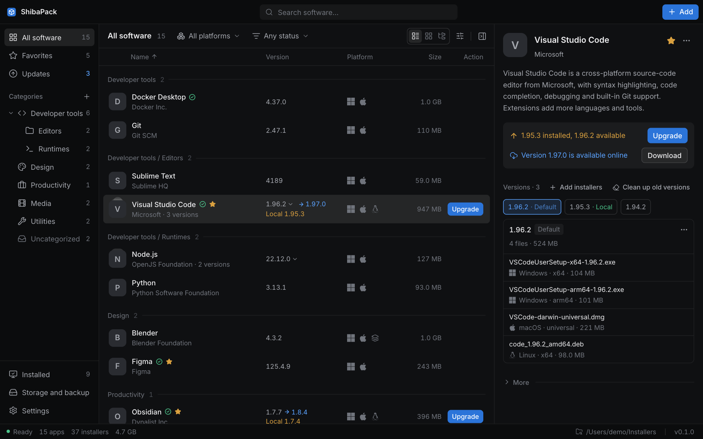
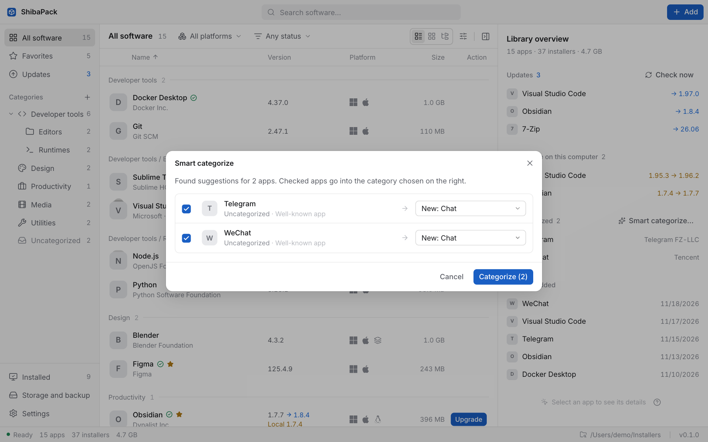

# ShibaPack

**English** · [简体中文](README.zh-CN.md)

A cross-platform manager for software installers. ShibaPack keeps the `.exe`, `.dmg`, `.msi`, `.deb`, `.apk` and other installers on your computer or NAS organized as **app → version → file**, tells you what is installed on this machine, and keeps everything up to date from online sources.

Everything lives in a folder you choose. The index is a plain `software.json` file at its root. There is no database.


## Features

- **Organized by app and version.** Drop installers in and ShibaPack reads the app name, version, platform and architecture from the file name, then files them as `App/Version/file`. When the file name has no version, it reads the product version, product name and company from the properties of Windows installers (exe and msi). What it reads is cached, and versions missed by earlier imports are filled in in the background. Duplicates are detected by SHA-256.
- **Confirm before importing.** Dropping files onto the window opens an import window: see what each file will be recognized as, choose the current category, smart categorize, a category of your choice or none, and pick how to store them. The window stays open while importing, shows progress, and ends with what was imported, what was already there and what failed, saying for each failure which step went wrong and why (permission denied, disk full, file in use…). Drop files on a category in the sidebar to import them straight into it.
- **Folders as installers.** A portable app's folder or a macOS `.app` can be imported as one app: the version, publisher and icon come from the main program inside, and **Run** opens that program. A folder full of installers still imports the installers inside it.
- **Three ways to add files.** *Copy* puts installers into the library folder. *Move* does the same and removes the originals (across drives it checks the copy first). *Record location only* remembers where a file already is (for example on a NAS) and never touches it.
- **Several versions per app.** Pick a default version or always use the newest, see which version is installed on this computer, and clean up old versions in one step.
- **Categories, favorites and smart categorize.** Nested categories, drag and drop to file apps, and a built-in, offline rule set that suggests a category for about 300 well-known apps. With an AI model set up, the AI can categorize instead, and write summaries for apps that have none.
- **Home.** A simple dashboard that opens first: computer name, OS, processor and memory; live CPU and memory use with a one-minute trend; free space on the system disk; the busiest processes; how many apps are in your library and installed, how many have updates, start at login, and how much can be cleaned; and recently installed apps. View all opens a task manager to search and sort every process and end one from the right-click menu (it's asked to quit first, with force quit as a fallback; system processes can't be ended). Data is only read while Home is open and nothing is stored.
- **Disk usage.** Scan your home folder, a disk or any folder (read-only; hundreds of thousands of files in seconds) and see where the space went as a sunburst or a treemap; click a folder to drill in. Right-click a block to open it, show it in Finder (File Explorer), copy its path or move it to the Trash; system folders, your home folder itself, apps and the library can't be moved from here. Results only live in memory.
- **Installed software.** Lists the apps installed on this computer (as a list or a grid; in the grid, hover over an app to see its summary), matches them with your library, and shows which ones can be upgraded from an installer you already have. The details pane shows a short summary of what each app does. Install, upgrade and uninstall from one place. Before uninstalling, ShibaPack analyzes the app and lists it together with its data, shortcuts, settings and registry entries (Library files on macOS) and their sizes; uninstall and clean up the ones you tick in one go, several apps at once, or clean only the data and keep the app. Files go to the Recycle Bin and registry entries are backed up first.
- **Startup items and services.** Lists what runs at login and in the background (login items, LaunchAgents and LaunchDaemons on macOS; Run keys, the Startup folder and services on Windows; autostart entries and systemd units on Linux) with the system's own descriptions. Enable, disable, start and stop them, and change the startup type of Windows services. System items are hidden by default and ask for confirmation before you change them. With an AI model set up, the AI can explain what an item does and whether it is safe to disable.
- **Clean up.** Finds temporary files, logs and crash reports, browser and app caches, developer tool caches, installers downloaded by package managers, and the Trash, and lists them by category with sizes and explanations. Browsing history, cookies (with a keep list so you stay signed in), recent files and the clipboard can be cleared too, but are never selected by default; passwords and bookmarks are never touched. System locations that need administrator rights (Windows Update downloads, memory dumps, /Library/Caches and more) are cleaned after a single authorization. Caches that regenerate by themselves are deleted outright; everything else goes to the Trash. Browsers and editors that must be closed first can be asked to quit from here. It also finds installers in Downloads and on the Desktop: copies identical to your library can be removed safely, and ones not yet in the library can be imported directly. System folders, personal folders, synced folders and the library are never touched, and every item is checked again right before it is deleted.
- **Online sources.** Link an app to Homebrew Cask, GitHub Releases or winget to check for new versions and download them into the library.
- **One search box for everything.** The search box in the top bar lists matches from the library, installed apps and startup items in a dropdown, and also searches GitHub and Homebrew. Pick a scope on its right to search only one place. Click an online result to see its latest release and add it to the library.
- **Real icons.** Icons are taken from installers and installed apps. For apps with a homepage or a GitHub repository, ShibaPack can also use the site icon or the repository owner's avatar. Apps without an icon get a plain gray letter tile.
- **Safe by default.** The index is backed up automatically (the last 8 copies, plus one per day for two weeks) and always right before a delete, deleted files go to a trash folder for 30 days, and a check finds files that went missing or changed size.
- **Failure log.** Failed imports, updates and startup item changes are recorded under **Settings → Failure log**. The log stays on this computer.
- **Offline catalog.** Optionally writes an `index.html` at the library root, so you can browse the library in any browser, even without ShibaPack.
- **Updates itself.** ShibaPack checks GitHub Releases and can install its own updates.
- Light, dark and paper themes, English and Chinese interface, and importable language packs.

## Screenshots

**App details.** Summary, install status, versions and the files in each version.



**Installed software.** What is installed here, and whether the library has an installer for it.


**Smart categorize.** Suggestions are shown first; nothing moves until you confirm.



**Add from an online source.** Search Homebrew, GitHub or winget and download the right installer.


## Download

Get the latest version from the [Releases page](https://github.com/Wonvy/ShibaPack/releases/latest).

| System | File |
|---|---|
| macOS (Apple silicon and Intel) | `ShibaPack_<version>_universal.dmg` |
| Windows | `ShibaPack_<version>_x64-setup.exe` or `ShibaPack_<version>_x64_en-US.msi` |
| Linux | `.AppImage`, `.deb` or `.rpm` |

The installers are not signed with an Apple or Microsoft certificate yet:

- **macOS:** the first time you open ShibaPack, macOS blocks it. Go to **System Settings → Privacy & Security** and click **Open Anyway**. If macOS says the app is damaged, run `xattr -dr com.apple.quarantine /Applications/ShibaPack.app` once.
- **Windows:** if SmartScreen appears, click **More info → Run anyway**.

After that, ShibaPack updates itself from GitHub Releases. If an automatic update on macOS says it isn't allowed to replace the app, allow ShibaPack under **System Settings → Privacy & Security → App Management**, or click **Download installer** in the update window and install it yourself.

## Getting started

1. On first launch, choose a folder for your library (a new empty folder, or one that already holds installers).
2. Add installers: drag files or folders onto the window and choose a category and storage in the import window, or drop them on a category in the sidebar to import them straight into it. You can also use **Add → Import files / Import folder**, or **Add → Add from an online source**.
3. Use **Smart categorize** on *Uncategorized* to file everything in one go.

A library folder looks like this:

```
Library/
├─ software.json            the index: categories, apps, versions, files, settings
├─ index.html               optional offline catalog
├─ Visual Studio Code/
│  ├─ 1.96.2/
│  │  ├─ VSCodeUserSetup-x64-1.96.2.exe
│  │  └─ VSCode-darwin-universal.dmg
│  └─ 1.95.3/
│     └─ VSCodeUserSetup-x64-1.95.3.exe
└─ .shibapack/              icons, index backups, trash, cache
```

Platforms, categories and favorites are only fields in the index, so changing them never moves files. If the index is ever lost, the `App/Version` folders are enough to rebuild it.

## Network and privacy

ShibaPack works offline. It goes online only for these:

- **Summaries and icons** (can be turned off in Settings): app names are sent to Wikipedia, Homebrew (`formulae.brew.sh`) and GitHub to look up a short description, and apps without an icon fetch one from their own homepage or their GitHub owner's avatar.
- **Summary translation** (can be turned off in Settings): a summary that isn't in the interface language is sent to Google Translate, or to MyMemory if Google can't be reached.
- **AI model** (only if you set one up in Settings): when you ask the AI to write a summary or to categorize, app names, publishers, homepages, installer file names, existing summaries and category names are sent to the service you chose. When you ask it to explain a startup item, that item's name, description, command and location are sent. When you ask it to explain a cleanup item, its name, folders (with your home folder written as `~`), size and the names of the largest few things inside are sent. The API key is kept only in this computer's system keychain. Local services such as Ollama and LM Studio keep everything on this computer.
- **Online sources**, when you link or check them: Homebrew (`formulae.brew.sh`), GitHub Releases, and the winget package list on GitHub.
- **Top-bar search**, when its scope is All, GitHub or Homebrew: what you type is sent to GitHub's repository search. Homebrew is searched in the catalog downloaded on first use, so search terms are not sent. The Library, Installed and Startup scopes stay offline.
- **Its own updates**: GitHub Releases of this repository (can be turned off in Settings).

## Development

Requirements: Node.js 20 or later and Rust (stable).

```bash
npm install
```

```bash
npm run app
```

`npm run app` opens the desktop window and reloads or restarts when the code changes.

To work on the interface without the desktop window, run it in a browser with mock data:

```bash
npm run dev
```

Then open <http://localhost:1430>. Add `?setup` to the address to see the first-run screen, `?offline` for the screen shown when the last repository can't be opened, `?empty` for an empty library, or `?en` for English demo data.

### Checks

```bash
npm run test:core
```

```bash
npm run typecheck
```

`test:core` runs the unit tests of the core library: reading and writing the index, backup and recovery, file name recognition, import and deduplication, folder installers, file properties, edits, icon extraction, installed software, startup items, online sources, downloads, web icons, the offline catalog and the failure log.

Tests that need the network are skipped by default. Run them with `--ignored`:

```bash
cargo test -p shibapack-core -- --ignored
```

### Self-test

Unit tests and the browser preview cannot reach the layer of "does the real window talk to the backend, and do icons show". Start the desktop app with the three variables below and it walks through those paths in a temporary library, prints the results to the terminal, and exits:

```bash
mkdir -p /tmp/shibapack-selftest/repo && echo '{"repoRoot": "/tmp/shibapack-selftest/repo"}' > /tmp/shibapack-selftest/config.json
```

```bash
SHIBAPACK_CONFIG=/tmp/shibapack-selftest/config.json SHIBAPACK_CACHE=/tmp/shibapack-selftest/cache SHIBAPACK_SELFTEST=/path/to/some-installer.exe ./target/debug/shibapack
```

`npm run dev` must be running and `cargo build -p shibapack` must have been run first (a release build does not need `npm run dev`). `SHIBAPACK_SELFTEST` points to an installer (use an exe or msi to test icons; icons are not extracted from dmg files); if a `lang.json` sits next to it, importing language packs is tested too. The cleanup checks only scan and run a cleanup with nothing selected; nothing on the computer is deleted. The online-source checks need the network. The two directory variables can also be used on their own to run the app with a separate config and cache, without touching your real data.

### Building

Build installers for the current system (needs the update signing key `~/.tauri/shibapack-updater.key`):

```bash
npm run bundle
```

The results are in `target/release/bundle/`.

### Releasing

Installed copies of ShibaPack update themselves from GitHub Releases. To publish a new version:

1. Set `version` in `package.json` to the new version (the app reads its version only from there).
2. Add a `## <version>` section to `CHANGELOG.md` with a Chinese and an English part. It becomes the release notes on GitHub and in the in-app update window (opened from the version number in the bottom-right corner).
3. Commit, then create a tag with the same version and push it:

   ```bash
   git tag v0.2.0 && git push origin main --tags
   ```

4. `.github/workflows/release.yml` builds on macOS, Windows and Linux and uploads the installers and, if the signing key is set up, the signed update bundles and `latest.json` to a draft release.
5. When all three builds succeed, the workflow publishes the release by itself, and installed copies pick up the update. If any build fails, the release stays a draft and is not published: fix the problem and build again, or check the draft on GitHub and click **Publish release** yourself.

If the first step, preparing the draft release, fails because GitHub refuses to create the release (`Resource not accessible by integration`), the workflow's token can't write: open the repository's Settings → Actions → General → Workflow permissions, choose **Read and write permissions**, save, and run it again. If that doesn't help, add a `RELEASE_TOKEN` as described at the top of `release.yml`.

#### Update signing key

The built-in updater only installs update bundles signed with ShibaPack's private key (the public half is in `plugins.updater.pubkey` in `src-tauri/tauri.conf.json`). This is separate from Apple or Microsoft code signing.

The key is optional for the workflow. Without it, a release has the installers only: no update bundles and no `latest.json`, so installed copies do not update to that release automatically and users download it themselves. To produce update bundles, add the key to the repository secrets (**Settings → Secrets and variables → Actions → New repository secret**):

- Name: `TAURI_SIGNING_PRIVATE_KEY`
- Value: the whole content of `~/.tauri/shibapack-updater.key`

Copy the key to the clipboard on macOS:

```bash
pbcopy < ~/.tauri/shibapack-updater.key
```

The key has no password and is not in the repository. Keep a backup: if it is lost, installed copies can never update automatically again.

### Project layout

```
crates/core/   core logic, independent of the UI and testable on its own
src-tauri/     desktop shell (Tauri 2): commands, events, windows
src/           interface (React + TypeScript + Tailwind)
docs/PLAN.md   design, data format, milestones and progress (Chinese)
```
