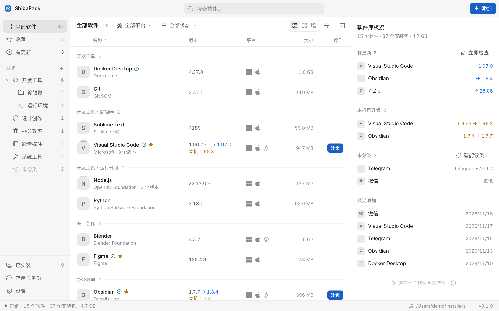
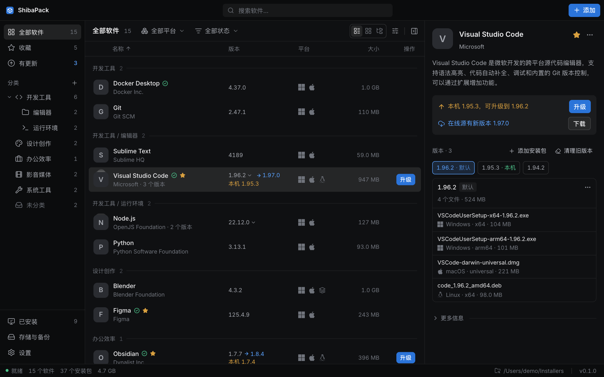
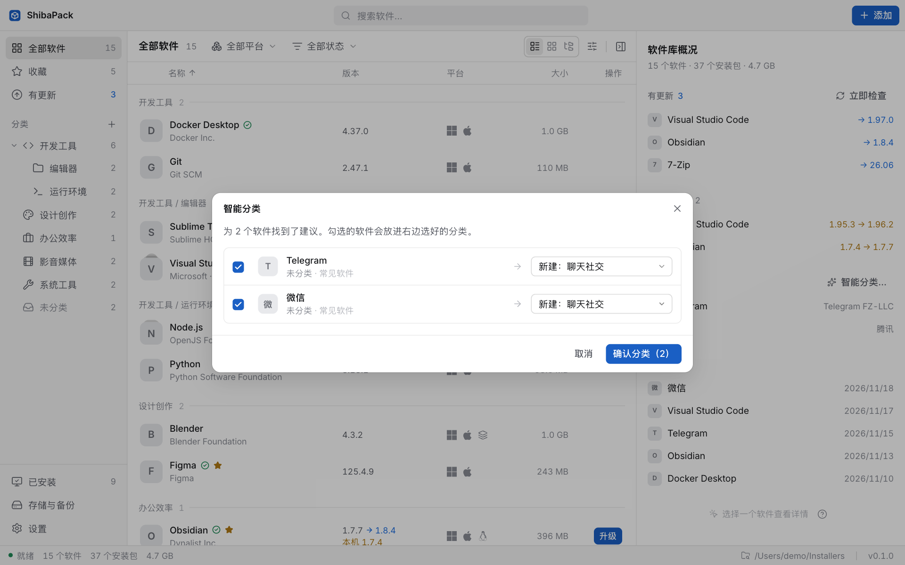
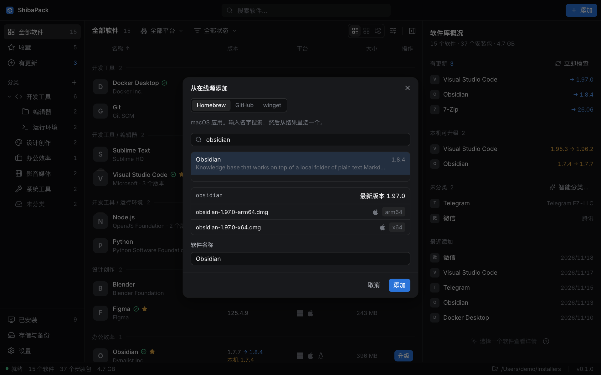

# ShibaPack

[English](README.md) · **简体中文**

跨平台的软件安装包管理器。把本机或 NAS 上的 `.exe`、`.dmg`、`.msi`、`.deb`、`.apk` 等安装包按“**软件 → 版本 → 文件**”整理起来，看得到这台电脑装了什么，还能从在线源检查和下载新版本。

所有数据都放在你指定的仓库文件夹里，索引是根目录下一个普通的 `software.json` 文件，不使用数据库。



## 功能

- **按软件和版本整理。** 把安装包拖进来，ShibaPack 从文件名认出软件名、版本号、平台和架构，按“软件名/版本号/文件”放好。文件名里看不出版本号时，读 Windows 安装包（exe、msi）文件属性里的产品版本、产品名和公司名，读过的会缓存，不会每次重读；以前导入时没认出版本的，也会在后台补上。用 SHA-256 判断重复。
- **导入前先确认。** 把文件拖进窗口，先弹出导入窗口：看一眼每个文件会被认成什么，选放进当前分类、智能分类、指定分类还是不分类，再选存储方式。确认后窗口不关，显示进度；导完列出导入、重复和失败的文件，失败的会写清楚在哪一步、什么原因（没有权限、磁盘满、被占用……）。直接拖到左栏的某个分类上，就导入进那个分类。
- **文件夹也能当安装包。** 绿色版软件的文件夹、macOS 的 `.app` 可以整个作为一个软件导入：版本号、发布者和图标从文件夹里的主程序取，“运行”时打开主程序。放着一堆安装包的文件夹照旧导入里面的安装包。
- **三种导入方式。** “复制进仓库”把安装包复制一份进来；“移动进仓库”放进来后不留原文件（跨磁盘时先核对复制无误再删）；“只记录位置”只记下文件在哪（比如在 NAS 上），不动原文件。
- **一个软件多个版本。** 可以指定默认版本或始终用最新版本，看得出本机装的是哪个版本，旧版本可以一键清理。
- **分类、收藏和智能分类。** 分类可以分级，拖动就能归类；内置约 300 个常见软件的离线规则，能给软件推荐分类；设置了 AI 模型时也可以让 AI 来分，还能让 AI 给找不到简介的软件写一段。
- **主页。** 打开就是一个简洁的看板：电脑名、系统、处理器和内存，CPU、内存的实时占用和最近一分钟的走势，系统盘还剩多少，占用最多的进程，软件库和已安装软件的数量、有几个能更新、几个开机自启、能清理多少，以及最近装的软件。“查看全部”是任务管理器：搜索、排序全部进程，右键结束（先请它正常退出，不行再强制结束；系统进程不能结束）。只在主页开着时读，什么都不存。
- **已安装软件。** 列出这台电脑上装的软件（列表或网格，网格里鼠标停一下就浮出简介），和仓库里的软件对应起来，标出哪些可以用仓库里的安装包升级；详情栏里有软件简介，看得出它是干什么的。安装、升级、卸载都在一处完成。卸载前先分析：列出软件本身和它的数据、快捷方式、设置、注册表项（macOS 上是资源库里的文件）各有多大，勾选后一起卸载和清理；可以一次卸载好几个，也可以只清理数据不卸载。文件移到回收站，注册表先备份再删。
- **启动项与服务。** 列出登录时自动运行的程序和后台服务（macOS 的登录项、LaunchAgents、LaunchDaemons，Windows 的 Run 键、“启动”文件夹和服务，Linux 的自动启动和 systemd），带上系统自带的说明，可以启用、停用、启动、停止，Windows 服务可以改启动类型。系统自带的项默认不列出，改动前会再确认；设置了 AI 模型时还能让 AI 解释某一项是做什么的、能不能停用。
- **清理。** 找出系统临时文件、日志和崩溃报告、浏览器和常用应用的缓存、开发工具缓存、包管理器下载的安装包和回收站，按类别列出大小和说明，勾选后清理。也能清浏览记录、Cookie（可以留一份保留名单，免得掉登录）、最近使用的文件和剪贴板，这些默认不勾；要管理员权限的系统位置（Windows 更新下载的文件、内存转储、/Library/Caches 等）一次授权清完。删了会自己重新生成的直接删除，别的移到回收站；要先关掉的浏览器、编辑器可以在这里让它正常退出。还会在下载文件夹和桌面上找安装包，和仓库一模一样的可以放心清掉，没收进仓库的可以直接导入。系统文件夹、个人文件夹、同步盘和仓库一律不碰，删每一条之前都再查一遍。
- **在线源。** 把软件关联到 Homebrew Cask、GitHub Releases 或 winget，检查新版本并下载进仓库。
- **一个搜索框搜所有地方。** 顶栏搜索在下拉框里同时列出软件库、已安装、启动项里的结果，还会在 GitHub 和 Homebrew 上找；右边可以选只搜某一处。点在线的结果就能查看最新版本并添加进仓库。
- **真实图标。** 从安装包和已安装的软件里取图标；填了主页或关联了 GitHub 的软件，还能用网站图标或仓库主人的头像。取不到图标时显示灰底首字。
- **默认就安全。** 索引自动备份（最近 8 份，再往前每天留一份、留两周），删除前一定先备份；删除的文件先进回收站、30 天后清除，还能检查哪些文件丢了或大小变了。
- **失败日志。** 导入、更新、启动项这些操作失败时记一笔，在“设置 → 失败日志”里查看。日志只存在这台电脑上。
- **离线目录。** 可以在仓库根目录生成一个 `index.html`，不装 ShibaPack、用任何浏览器也能翻看仓库。
- **自动更新。** ShibaPack 会从 GitHub Releases 检查并安装自己的新版本。
- 浅色和深色主题，中英文界面，可以导入语言包。

## 截图

**软件详情。** 简介、安装状态、各个版本和每个版本里的文件。



**已安装软件。** 这台电脑上装了什么，仓库里有没有它的安装包。


**智能分类。** 先给出建议，确认之后才会归类。



**从在线源添加。** 在 Homebrew、GitHub 或 winget 上搜索，下载合适的安装包。



## 下载

到 [Releases 页面](https://github.com/Wonvy/ShibaPack/releases/latest) 下载最新版本。

| 系统 | 文件 |
|---|---|
| macOS（Apple 芯片和 Intel） | `ShibaPack_<版本>_universal.dmg` |
| Windows | `ShibaPack_<版本>_x64-setup.exe` 或 `ShibaPack_<版本>_x64_en-US.msi` |
| Linux | `.AppImage`、`.deb` 或 `.rpm` |

安装包还没有做苹果或微软的系统级签名：

- **macOS：** 第一次打开会被系统拦下。到“系统设置 → 隐私与安全性”里点“仍要打开”。如果提示“已损坏”，运行一次 `xattr -dr com.apple.quarantine /Applications/ShibaPack.app`。
- **Windows：** SmartScreen 弹出时点“更多信息 → 仍要运行”。

之后 ShibaPack 会从 GitHub Releases 自动更新。如果 macOS 上自动更新提示没有权限替换应用，到“系统设置 → 隐私与安全性 → App 管理”里允许 ShibaPack，或者在更新窗口里点“下载安装包”手动安装。

## 上手

1. 第一次启动时选一个文件夹当仓库（新建的空文件夹，或者已经放着安装包的文件夹都行）。
2. 添加安装包：把文件或文件夹拖到窗口上，在弹出的导入窗口里选好分类和存储方式再导入；拖到左栏的某个分类上就直接导入进那个分类。也可以用“添加 → 导入文件 / 导入文件夹”，或者“添加 → 从在线源添加”。
3. 在“未分类”上用“智能分类”，一次把软件都归好类。

仓库文件夹的样子：

```
仓库/
├─ software.json            索引：分类、软件、版本、文件、设置
├─ index.html               可选的离线目录
├─ Visual Studio Code/
│  ├─ 1.96.2/
│  │  ├─ VSCodeUserSetup-x64-1.96.2.exe
│  │  └─ VSCode-darwin-universal.dmg
│  └─ 1.95.3/
│     └─ VSCodeUserSetup-x64-1.95.3.exe
└─ .shibapack/              图标、索引备份、回收站、缓存
```

平台、分类、收藏都只是索引里的字段，改了不会移动文件。索引万一丢了，靠“软件名/版本号”文件夹也能重建。

## 联网与隐私

ShibaPack 离线也能用，只在下面几种情况联网：

- **简介和图标**（可以在设置里关掉）：把软件名发给维基百科、Homebrew（`formulae.brew.sh`）和 GitHub 查一段简介；没有图标的软件，会访问它自己的主页取网站图标，或取 GitHub 仓库主人的头像。
- **简介翻译**（可以在设置里关掉）：简介不是界面语言时，把简介原文发给 Google 翻译，连不上时发给 MyMemory。
- **AI 模型**（只有在设置里配好了才会用）：让 AI 写简介或做智能分类时，把软件名、发布者、主页、安装包文件名、已有的简介和分类名发给你选的服务；让 AI 解释启动项时，发的是那一项的名字、说明、命令和登记位置；让 AI 解释清理项时，发的是名字、文件夹（用户文件夹写成 `~`）、大小和里面最大的几样的名字。API Key 只存在这台电脑的系统钥匙串里。Ollama、LM Studio 这类本机服务不会让内容离开这台电脑。
- **在线源**（关联或检查时）：Homebrew（`formulae.brew.sh`）、GitHub Releases、GitHub 上的 winget 软件清单。
- **顶栏搜索**（搜索范围是“全部”、GitHub 或 Homebrew 时）：输入的字发给 GitHub 的仓库搜索接口；Homebrew 是在第一次用时下载的目录里搜，搜索词不发出去。范围选软件库、已安装或启动与服务时不联网。
- **自己的更新**：本仓库的 GitHub Releases（可以在设置里关掉）。

## 开发

需要 Node.js 20 以上和 Rust（stable）。

```bash
npm install
```

```bash
npm run app
```

`npm run app` 会启动桌面窗口，改动代码后自动刷新或重启。

只想看界面时可以不启动桌面窗口，在浏览器里用模拟数据预览：

```bash
npm run dev
```

然后打开 <http://localhost:1430>。地址后加 `?setup` 看首次启动的引导页，加 `?offline` 看上次的仓库没打开时的引导页，加 `?empty` 看空仓库，加 `?en` 换成英文的演示数据。

### 检查

```bash
npm run test:core
```

```bash
npm run typecheck
```

`test:core` 运行核心库的单元测试（索引读写、备份恢复、文件名识别、导入去重、文件夹安装包、文件属性、增删改、图标提取、已安装软件、启动项、在线源解析、下载、网站图标、离线目录、失败日志）。

需要联网的测试平时不跑，要跑的时候加上 `--ignored`：

```bash
cargo test -p shibapack-core -- --ignored
```

### 自检

单元测试和浏览器预览都够不着“真实窗口里前后端是否连通、图标能否显示”这一层。带着下面三个环境变量启动桌面应用，它会用一个临时仓库把这些链路走一遍，结果打印在终端，然后自己退出：

```bash
mkdir -p /tmp/shibapack-selftest/repo && echo '{"repoRoot": "/tmp/shibapack-selftest/repo"}' > /tmp/shibapack-selftest/config.json
```

```bash
SHIBAPACK_CONFIG=/tmp/shibapack-selftest/config.json SHIBAPACK_CACHE=/tmp/shibapack-selftest/cache SHIBAPACK_SELFTEST=/path/to/some-installer.exe ./target/debug/shibapack
```

需要先有 `npm run dev` 在运行，并且已经 `cargo build -p shibapack`（用发布构建出来的程序则不需要 `npm run dev`）。`SHIBAPACK_SELFTEST` 指向一个安装包（要测图标就用 exe 或 msi，dmg 取不到图标）；它旁边如果有一个 `lang.json`，会顺带测语言包导入。清理只读地扫一遍、不选任何项清理一次，不删这台电脑上的任何东西。自检里的在线源几项需要联网。这两个目录变量也可以单独用来让应用使用另一份引导文件和缓存，不碰正式数据。

### 打包

本机打包当前系统的安装包（需要更新包的签名私钥 `~/.tauri/shibapack-updater.key`）：

```bash
npm run bundle
```

产物在 `target/release/bundle/` 下。

### 发布新版本

已安装的 ShibaPack 会从 GitHub Releases 自动更新。发布一个新版本的步骤：

1. 把 `package.json` 里的 `version` 改成新版本号（应用的版本号只认这一处）。
2. 在 `CHANGELOG.md` 里加一节 `## 版本号`，分“中文”和“English”两段。它会成为 GitHub 上的发布说明，也是应用里“软件更新”窗口（点右下角的版本号打开）显示的更新内容。
3. 提交，然后打一个同名的标签并推送：

   ```bash
   git tag v0.2.0 && git push origin main --tags
   ```

4. `.github/workflows/release.yml` 会在三个系统上构建，把安装包传到一个草稿 Release 里；设好了签名私钥时，还有带签名的更新包和 `latest.json`。
5. 三个系统全部构建成功后，流程会自己把它发布出去，已安装的 ShibaPack 随后收到更新。有任何一个系统失败，就停在草稿、不发布：修好后重新构建，或者在 GitHub 上检查草稿后自己点“Publish release”。

如果第一步“准备草稿 Release”就失败、提示 GitHub 不让创建 Release（`Resource not accessible by integration`），是工作流的令牌没有写权限：到仓库的 Settings → Actions → General → Workflow permissions，选“Read and write permissions”并保存，再重新运行。还不行的话，按 `release.yml` 开头的说明加一个 `RELEASE_TOKEN`。

#### 更新包签名私钥

内置的自动更新只安装用 ShibaPack 私钥签过名的更新包（公钥在 `src-tauri/tauri.conf.json` 的 `plugins.updater.pubkey`）。这和苹果、微软的系统级签名是两回事。

发布流程里这把私钥可以不设。不设时 Release 里只有安装包，没有更新包和 `latest.json`：已安装的 ShibaPack 不会自动更新到这个版本，要用户自己下载。想生成更新包，就把私钥放进仓库的 Secrets（Settings → Secrets and variables → Actions → New repository secret）：

- 名称：`TAURI_SIGNING_PRIVATE_KEY`
- 值：`~/.tauri/shibapack-updater.key` 这个文件的全部内容

在 macOS 上把私钥复制到剪贴板：

```bash
pbcopy < ~/.tauri/shibapack-updater.key
```

这把私钥没有设密码，也不在仓库里。请另外备份一份：丢了它，已安装的 ShibaPack 就再也不能自动更新了。

### 结构

```
crates/core/   核心逻辑，不依赖界面，可单独测试
src-tauri/     桌面外壳（Tauri 2）：命令、事件、窗口
src/           界面（React + TypeScript + Tailwind）
docs/PLAN.md   方案、数据格式、阶段与进度
```
